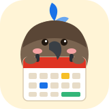

# skuaka

<p align="center"></p>

skuaka は、チームで予定を管理・共有するためのカレンダーです。ログインは OpenID Connect（OIDC）。ライセンス: MIT

- **表示**: 日・週・月・スケジュール（31日分の一覧）、ミニカレンダー、日本の祝日（振替休日・国民の休日を含む）、現在時刻の線、ダークモード、スマートフォンの画面幅
- **予定**: タイトル・日時・終日・複数日・場所・説明・色・通知（1つの予定に5つまで。予定の時刻〜1週間前。画面を開いている間にお知らせ・デスクトップ通知。プッシュ通知（PWA）を受け取る端末には画面を閉じていても届く。終日の予定は通知しない）
  - 週・日の表示で空いたところをドラッグして作成（日をまたいでもよい）、予定をドラッグで移動、下の端で長さを変更
  - 週の表示の終日の欄・月の表示では、空いたところをドラッグして、またいだ日数の終日の予定を作成。月の表示では予定をドラッグで別の日へ
  - 重なった予定は横に並べ、24時間以上の予定は「終日」の欄に帯で表示
- **繰り返し**（iCalendar の RRULE）: 毎日・毎週（曜日を複数）・毎月（日付 / 第n・最終の曜日）・毎年・平日、間隔・終わりの日・回数。
  カスタムでは、日にちを複数（「毎月15日と末日」）、第n週と曜日を複数（「第1・第3月曜日」）、そのうち何番目か（「毎月の最終平日」）、毎年の月（「3月と9月の第2日曜日」）も選べる。
  変更と削除は「この予定」「これ以降のすべての予定」「すべての予定」から選べる。夏時間をまたいでも現地の時刻を保つ
- **アイコン**: 設定の画面で画像を選ぶと、中央を正方形に切り抜いて保存する（PNG・JPEG・GIF・WebP。消すと IdP の画像に戻る）
- **カレンダー**: 1人に複数（ログインしたときに自分のカレンダーができる）、表示の切り替え、自分だけの表示の色
- **共有**: カレンダーをほかの人と共有（閲覧のみ / 予定の変更）。共有された人はサイドバーの「他のカレンダー」に出る
- **チームのカレンダー**: カレンダーごとにチームへの公開を選べる（公開しない / 予定あり・なしのみ / 予定の詳細。メインのカレンダーは「予定あり・なしのみ」が既定）。
  ほかの人はサイドバーの「他のカレンダー」の＋から探して加え、予定を重ねて表示できる（予定あり・なしのみなら題名・場所・説明・ゲストは「予定あり」に伏せる）
- **ゲスト**: 予定に人を招待（招待された人のカレンダーにも出る）。参加・不参加・未定の返事、ゲストの返事の一覧
- **リンクで公開（ログインしない人にも）**: カレンダーごとに秘密のリンクを発行し、リンクを知っている人はログインせずに閲覧のページ（`/p/…`）で見られる（日・週・月・スケジュール。閲覧だけ）。
  同じ値の iCalendar の URL（`/ics/….ics`）で、iCalendar の購読に対応したカレンダーアプリから購読もできる。
  公開の範囲は「予定あり・なしのみ」か「予定の詳細」。ゲストの一覧と主催者は出さない。作り直すと前のリンクは使えなくなる
- **外部のカレンダーの取り込み（Google カレンダー・Outlook・iCloud など）**: サイドバーの「マイカレンダー」の＋から。
  - **URL で購読**: iCalendar の URL（Google カレンダーの「iCal 形式の非公開 URL」など。`webcal://` も可）を入れると、読み取りだけのカレンダーとして表示し、1時間ごとに読み直す（元から消えた予定は消える）
  - **ファイルから取り込む**: 書き出した iCalendar（.ics. 10MB まで）の予定を、自分のカレンダーに写す（写した予定は変更できる）。同じファイルを取り込み直すと、重ならずに変わった予定だけを上書きする
  - 繰り返し（RRULE）・除外した回・一部の回の変更・終日・タイムゾーンも読む。skuaka で表せない繰り返し（年の何日目・第何週・1日に何回など）は近似する。通知とゲストは取り込まない
- **Web 会議（skaka）**: 設定の画面で skaka と連携すると（OAuth 2.0 の認可コード + PKCE）、予定の編集画面で「Web 会議（skaka）を付ける」を選べる。
  保存すると skaka に会議室を作り、場所に会議室の URL を入れる（予定の詳細に「Web 会議に参加」）。題名・日時を変えると会議室にも伝える
- **チャット（stui）**: 設定の画面で stui と連携すると、予定のリマインダーと招待が stui のボット「skuaka」からの DM でも届く（種類ごとに止められる）
- **通知先**: カレンダーの設定で、予定のリマインダー・追加・変更・削除を送る先を足せる（所有者と変更の権限がある人）。
  stui のチャンネル（自分の連携で、参加しているチャンネルを選ぶ）・stui の受信 Webhook の URL・Webhook（任意の URL に署名付きの JSON）。
  送れなければ間を空けて送り直し、最後の送信の結果と最近の記録を見られる。「テストを送る」で確かめられる
- **検索**（タイトル・場所・説明）、キーボードの操作（`t` 今日・`j`/`k` 前後・`d`/`w`/`m`/`a` 表示・`c` 作成・`/` 検索・`?` 一覧）
- **API トークン**: 設定の画面で作成・失効（読み書き / 参照のみ、有効期限）。`Authorization: Bearer skuaka_…` で画面と同じ REST API を呼べる
  （一覧は `GET /api/endpoints`）
- **MCP**: `POST /mcp`（Streamable HTTP）。MCP に対応した AI アシスタントから予定の一覧・検索・作成・変更・削除、招待への返事、空き時間の検索ができる
- **同時の編集**: 楽観ロック（ほかの人が先に変えたら 409）。ほかの人の変更は1分ごと・画面に戻ったときに読み直す

技術: Scala 3.9 LTS、Cats Effect 3、http4s 1.0（マイルストーン版）、doobie、Flyway、PostgreSQL 17、
Scala.js + [Scalactive](https://github.com/Ondeoma/scalactive)、Vite。設計は [docs/design.md](docs/design.md) を参照してください。

## 構成

| モジュール | 内容 |
|---|---|
| `modules/shared` | バックエンドと画面（Scala.js）で共有する API の型（circe）と、繰り返し（RRULE）の読み書き |
| `modules/core` | 繰り返しの展開、iCalendar の書き出し（純粋なロジック） |
| `modules/db` | doobie のストア、Flyway のマイグレーション |
| `modules/observe` | 観測（OpenTelemetry. ログ・メトリクス・トレースを OTLP で skorimako に送る） |
| `modules/push` | プッシュ通知（PWA. Web Push の暗号化と VAPID. 招待と予定のリマインダーを送る） |
| `modules/auth` | OIDC（Authorization Code + PKCE + nonce、ID トークンの署名の検証（JWKS）、IdP からのログアウト） |
| `modules/devidp` | 開発・テスト用の簡易 OIDC プロバイダ（本番では使わない） |
| `modules/api` | http4s のルート（認証・カレンダー・予定・iCalendar の配信） |
| `modules/app` | 起動・設定（環境変数）・画面の配信 |
| `modules/web` | 画面（Scalactive の `.st` 単一ファイルコンポーネント） |
| `frontend/` | Vite（Scala.js の出力をまとめてビルドする） |

## 開発

必要なもの: JDK 25、sbt、Node.js、Docker。

```bash
docker compose -f docker-compose.dev.yml up -d --wait   # PostgreSQL（:54349。テスト用の DB skuaka_test も作る）
scripts/dev-restart.sh                                   # バックエンドを :8105 で起動（DEV_LOGIN=true。名前だけでログインできる）
(cd frontend && npm install && npm run dev)              # 画面の開発サーバー http://localhost:5175（/api・/auth・/ics は :8105 へ中継）
sbt ~web/fastLinkJS                                      # 画面の変更を再リンクし続ける（ブラウザを再読み込みすると反映）
```

**OIDC で試す**: 開発用の IdP（:9095）を起動し、バックエンドを OIDC の設定で起動し直します。
IdP の画面で名前・メールアドレス・グループを入れると、その人として ID トークン（RS256）が発行されます。

```bash
scripts/dev-idp.sh
OIDC=dev scripts/dev-restart.sh
```

テスト（コア・OIDC の検証・開発用 IdP を使ったログインから予定の操作までの通しのテスト。DB は docker-compose.dev.yml）:

```bash
sbt test
```

**DB マイグレーション**（`modules/db/src/main/resources/db/migration`）: スキーマを変えるときは新しい番号の `V<n>__*.sql` を追加し、適用済みのファイルは書き換えないでください。

## 配布・起動

```bash
scripts/dist.sh                   # dist/lib/*.jar と dist/static（画面）を作る
java -cp 'dist/lib/*' skuaka.app.Main
```

Docker: `scripts/dist.sh` のあと `docker build -f deploy/docker/app.Dockerfile -t skuaka .`

環境変数（すべては `modules/app/src/main/scala/skuaka/app/Main.scala` の `Config`）:

| 変数 | 内容 |
|---|---|
| `DATABASE_URL` / `DATABASE_USER` / `DATABASE_PASSWORD` | PostgreSQL（`jdbc:postgresql://…`） |
| `PUBLIC_URL` | 公開 URL（`https://` なら Cookie に Secure が付く。iCalendar の配信の URL にも使う） |
| `OIDC_ISSUER` / `OIDC_CLIENT_ID` / `OIDC_CLIENT_SECRET` | OIDC。IdP には Redirect URI `${PUBLIC_URL}/auth/callback`、ログアウト後の戻り先 `${PUBLIC_URL}/` を登録する |
| `OIDC_SCOPES` | 要求するスコープ（既定 `openid profile email`） |
| `OIDC_GROUPS_CLAIM` / `OIDC_ALLOWED_GROUPS` | 所属グループのクレーム名（既定 `groups`）と、ログインを許すグループ（カンマ区切り。未設定ならだれでも） |
| `SESSION_DAYS` | ログインの有効日数（既定 14） |
| `HTTP_PORT` | 待ち受けるポート（既定 8080） |
| `RATE_LIMIT_AUTH` / `RATE_LIMIT_PUBLIC` | IP ごとの1分あたりの回数の上限。ログインと OAuth の認可の画面（`/auth/…`・`/oauth/authorize`、既定 20）と、OAuth のトークンの発行・失効（`/oauth/token`・`/oauth/revoke`）・公開リンク（`/api/public/…`・`/ics/…`）（既定 120）。0 で制限しない。超えたら 429 |
| `TRUSTED_PROXIES` | リバースプロキシの IP か CIDR（カンマ区切り）。そこから来た要求だけ `X-Forwarded-For` から利用者の IP を読む。未設定なら直接つないできた相手の IP で数える |
| `STATIC_DIR` | ビルド済みの画面（`dist/static`） |
| `APP_SECRET` | 秘密の値（連携のトークン）を暗号化する鍵（16文字以上. skaka・stui と連携するときは必須） |
| `SKAKA_URL` / `SKAKA_CLIENT_ID` / `SKAKA_CLIENT_SECRET` | Web 会議（skaka）との連携（3つとも設定したときだけ）。skaka には Redirect URI `${PUBLIC_URL}/api/integrations/skaka/callback` を登録する |
| `OAUTH_CLIENTS` | skuaka を使う兄弟のサービス（OAuth の認可コード + PKCE）。JSON の配列 `[{"id":"skakapo","secret":"…(16文字以上)","redirectUri":"https://…/api/connections/callback","name":"skakapo","scopes":["read","write"]}]`（`scopes` を省くと read だけ） |
| `SKAKA_INTERNAL_URL` | サーバーから skaka を呼ぶ URL（省けば `SKAKA_URL`） |
| `STUI_URL` / `STUI_CLIENT_ID` / `STUI_CLIENT_SECRET` | チャット（stui）との連携（3つとも設定したときだけ）。stui の `OAUTH_CLIENTS` に skuaka を登録する（`redirectUri` は `${PUBLIC_URL}/api/integrations/stui/callback`、`scopes` は `["read","write"]`） |
| `STUI_INTERNAL_URL` | サーバーから stui を呼ぶ URL（省けば `STUI_URL`） |
| `WEBHOOK_ALLOW_HTTP` | カレンダーの通知先（Webhook）に http:// の URL も許す（開発用） |
| `WEBHOOK_ALLOW_INTERNAL` | 通知先に送ってよい内部のアドレス（CIDR・IP・ホスト名をカンマ区切り）。既定は空（外のアドレスだけ）。`STUI_URL`・`STUI_INTERNAL_URL` のホストは書かなくても許す |
| `OTEL_EXPORTER_OTLP_ENDPOINT` / `OTEL_EXPORTER_OTLP_HEADERS` | ログ・メトリクス・トレースの送り先（skorimako の URL と `Authorization=Bearer sko_…`（ingest のキー））。未設定なら送らない。そのほか OpenTelemetry の標準の `OTEL_*` が使える |
| `LOG_FORMAT` / `LOG_LEVEL` | 標準出力のログの形（`text`（既定）・`json`）と水準（既定 `INFO`）。ログにはトレースの ID と操作したユーザーが付く |
| `SKORIMAKO_RUM_TOKEN` / `SKORIMAKO_RUM_URL` / `SKORIMAKO_RUM_SAMPLE_RATE` | 画面のブラウザの観測（skorimako の RUM）。トークンは skorimako の管理の画面で登録したアプリのもの。URL を省略すると `SKORIMAKO_URL` |
| `VAPID_SUBJECT` | プッシュ通知（PWA）の連絡先（`mailto:…` か `https://…`。省略すると `PUBLIC_URL`）。VAPID の鍵は初回の起動で作って DB に保存する |
| `ICS_SYNC_MINUTES` | iCalendar の URL の購読を読み直す間隔（分. 既定 60、5以上） |
| `ICS_ALLOW_PRIVATE_URLS` | `true` なら、購読の URL に内部のアドレス（localhost・社内のネットワーク）も許す（開発用. 本番では使わない） |
| `DEV_LOGIN` | 開発用のログインを有効にする（OIDC を設定せず、`PUBLIC_URL` が localhost の場合のみ。本番では使えない） |

### OIDC の IdP の設定

OpenID Connect の Discovery（`/.well-known/openid-configuration`）に対応した IdP で使えます。

- クライアントの種類: コンフィデンシャル（クライアントシークレットあり）、フロー: Authorization Code（PKCE の S256 を使う）
- Redirect URI: `${PUBLIC_URL}/auth/callback`
- ログアウト後の戻り先（post_logout_redirect_uri）: `${PUBLIC_URL}/`（IdP に end_session_endpoint があれば、skuaka のログアウトで IdP からもログアウトする）
- ID トークンに `email`・`name` があると、共有・招待の相手を探しやすくなります。グループで制限するときは `groups` クレームを出す設定にしてください

## API トークンと MCP

設定の画面（右上のメニュー →「設定」）の「API トークンと MCP」でトークンを作ります。値は作成したときだけ表示され、DB には SHA-256 だけを保存します。
トークンの権限は作った人と同じで、「参照のみ」のトークンは GET（MCP では参照のツール）だけが使えます。トークンの作成・失効は画面からだけできます。

### 兄弟のサービスとの連携（OAuth）

`OAUTH_CLIENTS` に登録したサービス（AI エージェントの skakapo など）は、利用者の許可を得て、その人の権限で REST API と MCP を使えます。

- `GET /oauth/authorize`（`response_type=code`、PKCE は `S256` だけ、`scope` は `read`・`write` のうちクライアントに許したもの。省くと `read`）。未ログインならログインしてから許可の画面に戻る
- `POST /oauth/token`（クライアントの認証は Basic）。`grant_type` は `authorization_code` と `refresh_token`。アクセストークンは1時間で切れ、refresh token は使うたびに新しくなる
- `POST /oauth/revoke`（RFC 7009。アクセストークンでも refresh token でもよい）
- 発行したトークンは「<サービス名> 連携」の API トークンで、`read` だけなら参照のみ。設定の画面の「連携しているサービス」で確かめ・取り消せる。許可し直すと前のトークンは失効する

REST API:

```bash
curl -H "Authorization: Bearer skuaka_…" "https://cal.example.com/api/events?from=2026-11-01&to=2026-12-01&tz=Asia/Tokyo"
```

MCP（URL は `${PUBLIC_URL}/mcp`、トランスポートは Streamable HTTP）。MCP クライアントの設定の例:

```json
{
  "mcpServers": {
    "skuaka": {
      "type": "http",
      "url": "https://cal.example.com/mcp",
      "headers": { "Authorization": "Bearer skuaka_…" }
    }
  }
}
```

| ツール | 内容 |
| --- | --- |
| `get_me` | 自分の情報・タイムゾーン・今日の日付 |
| `list_calendars` | 見られるカレンダーと権限 |
| `list_team_calendars` / `add_team_calendar` | チームの人が公開しているカレンダーを探す・自分の一覧に加える |
| `list_events` | 期間の予定（繰り返しは1回ずつ。`occurrence` 付き） |
| `search_events` | タイトル・場所・説明で探す |
| `get_event` | 予定の詳細（ゲストと返事・繰り返し） |
| `create_event` / `update_event` / `delete_event` | 予定の作成・変更・削除（繰り返しは `occurrence` と `scope`: this / following / all） |
| `respond_to_event` | 招待への返事 |
| `find_free_time` | 自分（と `people` で指定した人）の予定が入っていない時間（終日の予定と不参加の予定は空きとみなす） |
| `list_api_endpoints` / `call_api` | 専用のツールがない操作（カレンダーの作成・共有など）を REST API で |

MCP のツールでは、日時をトークンの持ち主のタイムゾーン（`yyyy-MM-ddTHH:mm`）で読み書きします。参加者はメールアドレス・名前、カレンダーは名前で指定できます。
